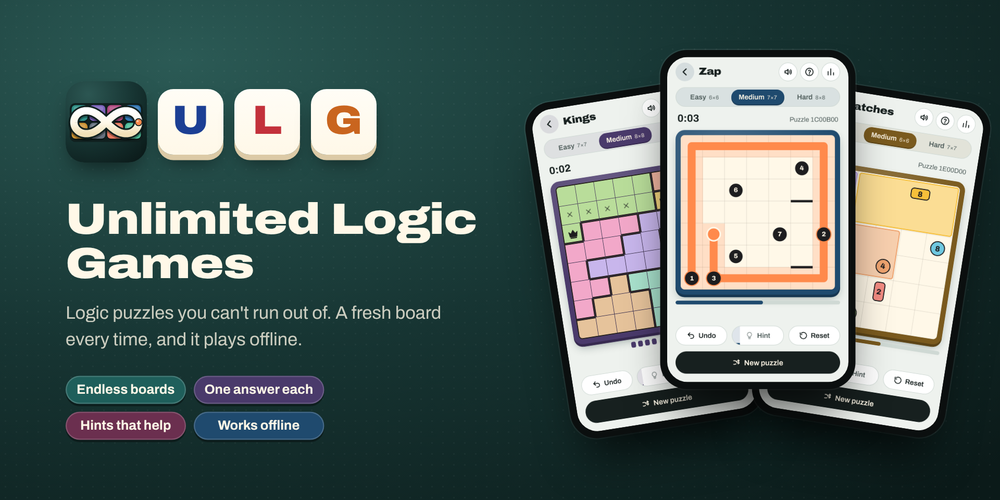
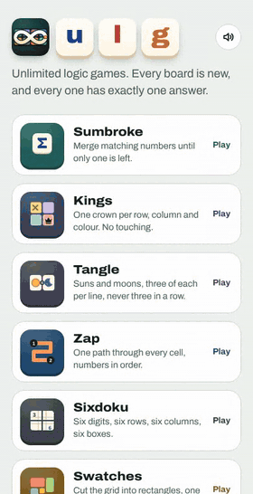
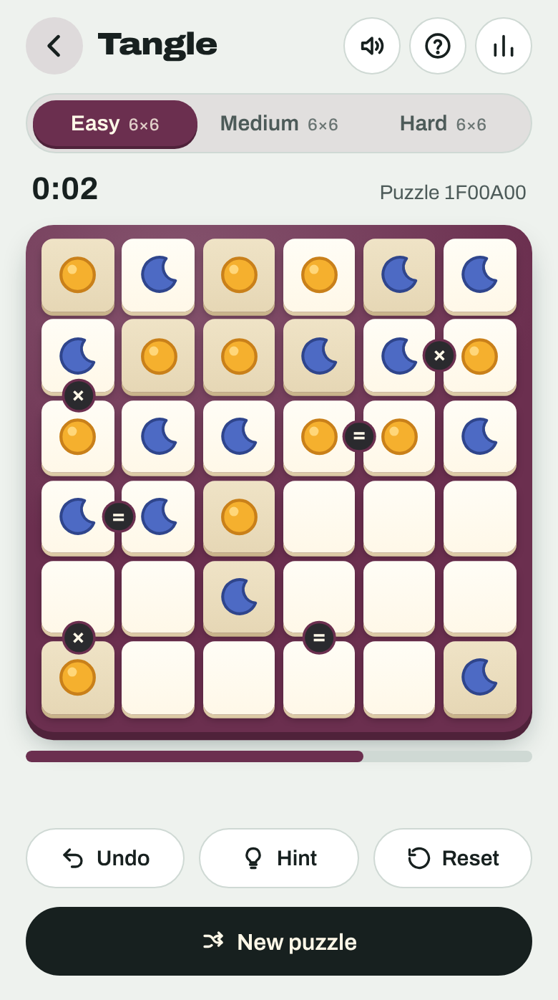
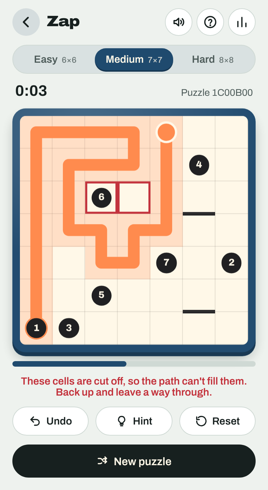
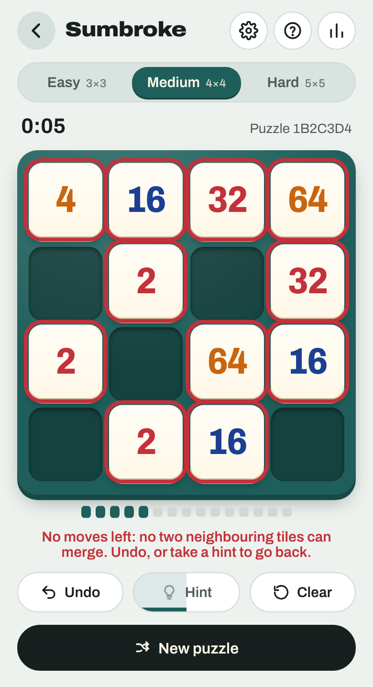
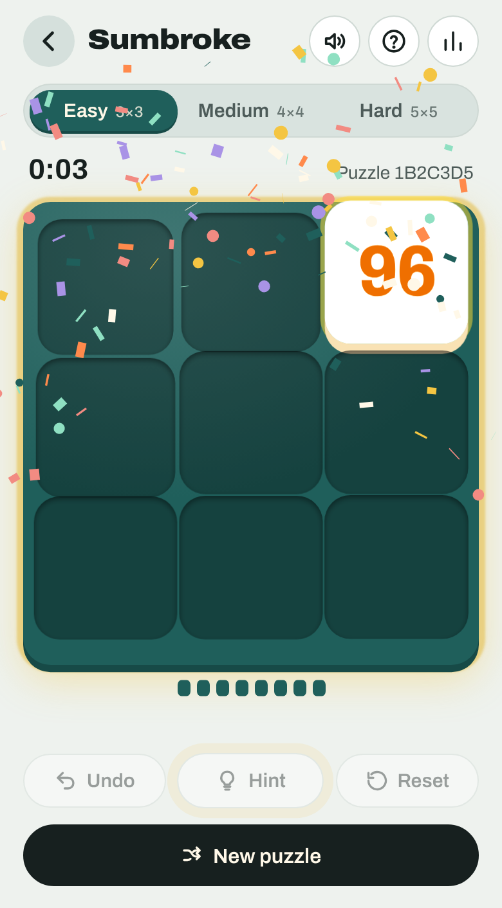

<p align="center">
  
</p>

<p align="center">
  <a href="https://github.com/khjabir/ulg/actions/workflows/ci.yml"></a>
  
  
  
  
  
</p>

**ULG** is a growing collection of logic puzzles that never runs out. Every board is
generated on your device and has exactly one solution, and most take between one and
five minutes. Add it to your home screen and it plays like an app, with or without a
connection.

Each game is a self-contained module, so the shelf keeps growing:
[adding another](#add-your-own-game) doesn't touch the rest.

<p align="center">
  
</p>

## The games so far

<table>
  <tr>
    <td align="center" width="33%">
      <br>
      <b>Sumbroke</b><br>
      <sub>Drag a number onto a matching neighbour to merge them. Keep going until one number is left. Gold wildcards like <code>+3</code> or <code>×2</code> merge with any number.</sub>
    </td>
    <td align="center" width="33%">
      <br>
      <b>Kings</b><br>
      <sub>Place one king in every row, column and coloured region. Like kings in chess, they can never touch, not even diagonally.</sub>
    </td>
    <td align="center" width="33%">
      <br>
      <b>Tangle</b><br>
      <sub>Fill the grid with suns and moons: three of each per row and column, never three in a row. <code>=</code> means match, <code>×</code> means opposite.</sub>
    </td>
  </tr>
  <tr>
    <td align="center">
      <br>
      <b>Zap</b><br>
      <sub>Draw one path from 1 through every number in order. It has to fill every cell, and it can't cross a wall.</sub>
    </td>
    <td align="center">
      <br>
      <b>Sixdoku</b><br>
      <sub>Sudoku on a 6×6 grid: digits 1 to 6 once per row, column and 2×3 box. Pencil notes included.</sub>
    </td>
    <td align="center">
      <br>
      <b>Swatches</b><br>
      <sub>Cut the grid into rectangles with exactly one clue in each. A clue can give the size, the shape, both, or neither.</sub>
    </td>
  </tr>
</table>

Every game sets its own levels. Today's games each have three:

| Game | Easy | Medium | Hard |
| --- | --- | --- | --- |
| Sumbroke | 3×3, up to 1 wildcard | 4×4, 1–2 wildcards | 5×5, 2–3 wildcards |
| Kings | 7×7 | 8×8 | 9×9 |
| Tangle | 6×6, extra givens | 6×6 | 6×6, fewest givens |
| Zap | 6×6 | 7×7 with walls | 8×8, more walls |
| Sixdoku | 16 givens | 12 givens | as few as possible |
| Swatches | 5×5, full clues | 6×6, some shapes hidden | 7×7, sizes and shapes hidden |

## Why it's fun to play

- **It never runs out.** Tap *New puzzle* and a fresh board appears. A generator built for each game guarantees there's exactly one solution, so you never have to guess.
- **It tells you when something's wrong, and only then.** If a piece breaks its own rule (a 5 that isn't 5 cells, two kings in one row), the game names the rule and rings the piece. If you hit a real dead end (a Zap path that can't move, a Sumbroke board with no merges left), it says so and suggests a way back. It never looks ahead or gives away deductions: working those out is the game.
- **Hints help, after a short wait.** A hint clears anything that can't be right and shows the next step. In Sumbroke and Zap, it takes you back to your last good position first. The Hint button fills like a progress bar for 10 seconds of play before each hint, so a quick tap can't replace thinking.
- **It feels like a game table.** You get chunky tiles you drag around, wooden clacks, chimes as a path grows, a soft buzz on phones, and a wave of confetti when you solve it.
- **Drawing is forgiving.** Zap's line follows your finger smoothly. In Swatches you can start a drag anywhere, even on the clue, and sweep one way and then back the other. You can also grab a drawn swatch by its edge to resize it. Drags that overshoot the board's edge still land on the edge row.
- **You can challenge a friend.** Every board has a code, and *Challenge a friend* shares a link that rebuilds exactly the same puzzle.
- **It keeps your place.** Games in progress, best times, averages and hint-free streaks are all saved on the device.
- **It's a real app.** Install it from the home screen card or the ⋯ menu and it opens full screen with its own icon and launch screen, and plays offline. When a new version comes out, it asks before updating. It supports dark mode and full keyboard play, and it respects reduced motion.

<p align="center">
  
  &nbsp;
  
</p>
<p align="center"><sub>Truly stuck? The game says so and shows you where</sub></p>

<p align="center">
  
  &nbsp;
  
  &nbsp;
  
</p>
<p align="center"><sub>The home screen, a win in progress, and dark mode</sub></p>

## Play it

### Run it locally

You need Node.js 22 or newer (`.nvmrc` has the version CI uses).

```bash
npm install
npm run dev        # open http://localhost:3000
```

### Put it on your phone

Build the static site and host it anywhere that serves files over HTTPS:

```bash
npm run build      # writes the site to out/
npm start          # preview out/ locally
```

| Host | How |
| --- | --- |
| Vercel | Import the repo. The default settings work. |
| Netlify or Cloudflare Pages | Build command `npm run build`, publish directory `out` |
| GitHub Pages | `BASE_PATH=/your-repo npm run build`, then publish `out/` |

### Install it

Open the site on your phone. A **Get the ULG app** card on the home screen, and the
**⋯** menu, walk you through installing it:

- **Android (Chrome, Edge, Samsung Internet):** tap **Install**.
- **iPhone and iPad:** tap **Share**, then **Add to Home Screen**. The card's **How?** button shows the steps.
- **Computer (Chrome or Edge):** click **Install** on the card, or the install button in the address bar.

The installed app opens full screen from its own icon, with a launch screen, shortcuts
to each game (long-press the icon on Android), and no browser bars. It plays offline.

### Updates

Deploy a new build to the same address and every installed copy picks it up:

1. The app checks for a new version when it opens, when it comes back to the
   foreground, and every 30 minutes. You can also tap **⋯ → Check for updates**.
2. The new version downloads in the background, while the current one keeps running.
3. A banner says **A new version of ULG is ready**. **Update** switches over and
   reloads. A game in progress picks up exactly where it was. **Later** waits, and the
   new version applies itself the next time the app is fully closed and reopened.

Bump `version` in `package.json` before you deploy, so the menu shows which version a
player is on.

> Offline mode only switches on in production builds. Use `npm run build && npm start`
> to try it on your computer.

## How the puzzles are made

<details>
<summary><b>Every board has exactly one solution. Here's how each generator gets there, and how the games spot trouble.</b></summary>

<br>

| Game | Method |
| --- | --- |
| **Sumbroke** | Starts from a single number and "un-merges" it until the board is full, so a solution always exists. A solver then makes sure the opening has real traps. |
| **Kings** | Places kings that don't touch, grows a coloured region around each one, then reshapes regions until a solver finds only one answer. |
| **Tangle** | Builds a valid grid of suns and moons, adds `=` and `×` signs, then removes givens one at a time while the answer stays unique. |
| **Zap** | Builds a random path through every cell. It then adds checkpoints and walls that rule out every rival path, and drops any checkpoint it doesn't need. |
| **Sixdoku** | Fills a valid grid, then removes digits while the answer stays unique, down to a target for each level. |
| **Swatches** | Splits the grid into random rectangles, places a clue in each, and checks uniqueness with an exact-cover search. Harder levels hide sizes and shapes as long as the answer stays unique. |

Puzzles come from a seeded random generator, so the same code always rebuilds the same board.
Generation runs in a Web Worker, so the screen never freezes. The puzzle tests generate
hundreds of boards and check that each one is deterministic, has exactly one valid solution,
and can be solved using hints alone.

After every move, each game also runs a quick `check`. It reports only a piece that breaks
its own rule, or a true dead end where no move is left. It never looks ahead, and never
peeks at the answer. The tests walk every solution step by step to make sure the check
stays quiet, then play thousands of random games. Every board it flags must really be
unfinishable, and every real dead end must be caught.

</details>

## Under the hood

- **Next.js 16** (App Router, static export) with **React 19** and strict **TypeScript**.
- No backend and no tracking. Everything runs in the browser, and progress lives in `localStorage`.
- Sound effects are synthesized with the Web Audio API, so the project ships no audio files.
- A hand-written service worker precaches every page for offline play, and holds each update until the player says go.
- The only font is Archivo, served from the app itself.

```
src/
  app/                 one folder per game route, home page, not-found page, manifest
  core/                game shell (timer, undo, hints, stats, saving), hub, sounds,
                       confetti, pointer-to-cell geometry, worker client
  games/<game>/        engine.ts (generator, rules, hint, check), Board.tsx, index.tsx (rules text)
  games/registry.ts    the list of games on the home screen
  styles/              shared styles plus one stylesheet per game
  worker/              the Web Worker that builds puzzles
public/                logo, icons, launch screens, store screenshots, offline service worker
scripts/               icon and worker builds, service-worker precache, puzzle tests
docs/                  README images (banner.html is the banner's source)
```

| Command | What it does |
| --- | --- |
| `npm run dev` | Start the development server |
| `npm run build` | Build the static site into `out/` |
| `npm start` | Serve `out/` locally |
| `npm test` | Generate puzzles for every game and level, and verify them |
| `npm run typecheck` | Run the TypeScript checks |
| `npm run icons` | Redraw the logo, every app icon and the iPhone/iPad launch screens |

## Add your own game

ULG is built to grow. The shell provides the home-screen card, app shortcut, offline
cache, levels, timer, undo, hints, saving, stats, sounds, confetti and problem messages.
A new game brings only its own rules and board.

Every game is a `GameDef`:

```ts
export const mygame: GameDef<MyPuzzle, MyState, number[]> = {
  id: "mygame",
  name: "My Game",
  blurb: "One line for the home screen.",
  levels: [{ id: "easy", label: "Easy", detail: "5×5" } /* , … */],
  theme: { felt: "#1f5f5b", feltDeep: "#174a47" },
  initialState, // the board before the first move
  isSolved,     // has the player won?
  progress,     // how much is done, for the progress bar
  hint,         // the next step, or a way back to the last good position
  check,        // optional: a piece breaking its own rule, or a true dead end, or null
  hintWait,     // optional: how long the hint takes to recharge (10 s by default)
  Board,        // draws the board; calls apply(next) for every move
  HowTo,        // the rules, shown before the first game
  Icon,         // the home-screen picture
};
```

1. **Write the game** in `src/games/<id>/`. Copying the closest existing game is the
   quickest start.
   - `engine.ts`: a `generate(level, seed)` that always yields exactly one solution, plus the rules, `hint` and `check`.
   - `Board.tsx`: give the cells listed in the `flagged` prop the `flagged` class, so problems are ringed in red.
   - `index.tsx`: the `GameDef` above.
2. **Register it.** Add its id to `GameId` in `src/core/puzzle.ts`, its generator to
   `src/games/engines.ts`, its definition to `src/games/registry.ts`, and its name and
   blurb to `src/games/meta.ts`.
3. **Give it a page.** Add `src/app/<id>/page.tsx` (copy any of the four-line pages), and
   import the game's stylesheet in `src/app/layout.tsx`.
4. **Test it.** Add a case to `scripts/test-engines.ts` and run `npm test`.

To rename a game, change `name` in its `index.tsx` and in `meta.ts`. Old addresses listed
in `LEGACY_IDS` forward to the new ones, and saved progress moves across automatically.

## Contributing

Pull requests are welcome: bug fixes, polish, docs, and new games. Read
[CONTRIBUTING.md](CONTRIBUTING.md) first; the pull request template walks you through
the rest.

Every pull request runs [CI](.github/workflows/ci.yml): a clean install, the puzzle
engine tests, a production build, a type check, and a check that every page was built
and the offline worker is complete. The built site is attached to the run, so
reviewers can try it. Run the same commands locally before you push:

```bash
npm test && npm run build && npm run typecheck
```

## Credits

Fan-made puzzles inspired by the daily logic games on LinkedIn. Not affiliated with or
endorsed by LinkedIn.

Set in [Archivo](https://fonts.google.com/specimen/Archivo) by Omnibus-Type (SIL Open
Font License). To use `docs/social-preview.png` as the link preview, upload it under
**Settings → Social preview** on GitHub.
