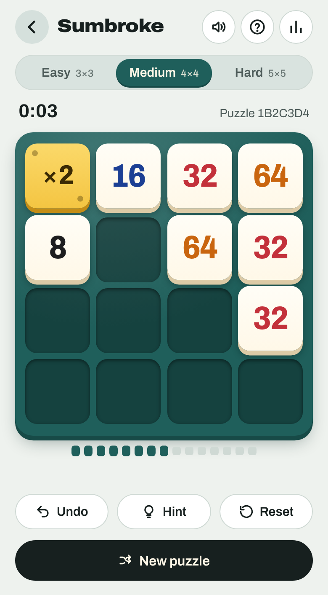
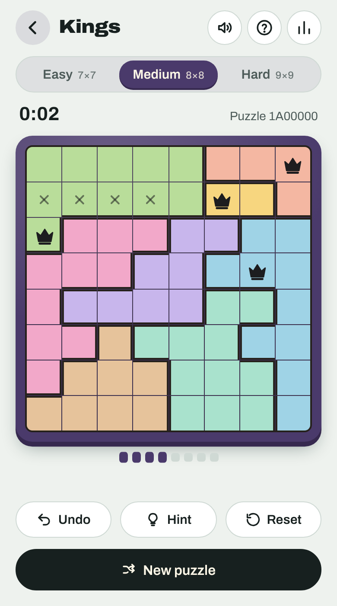
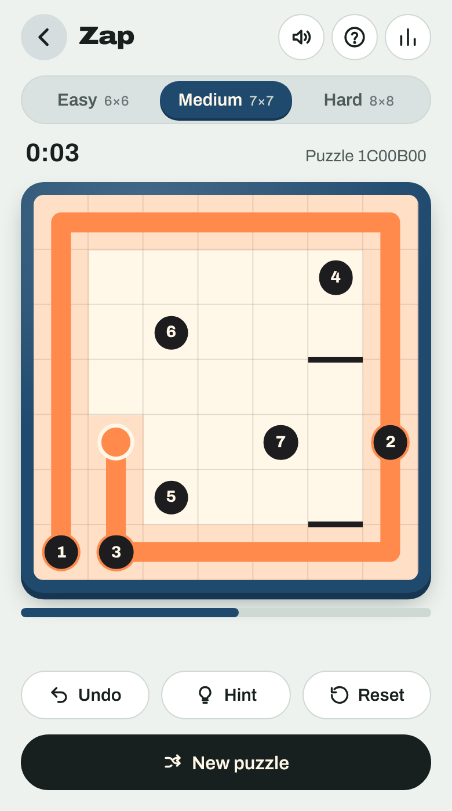
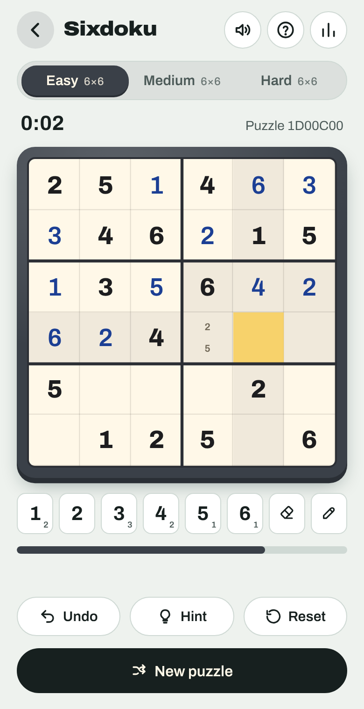
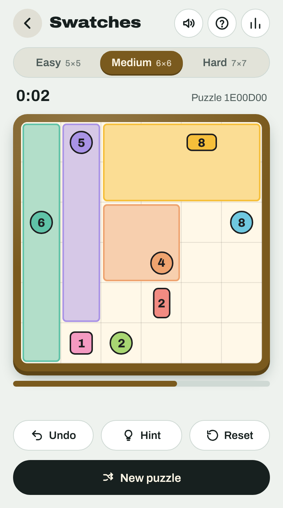
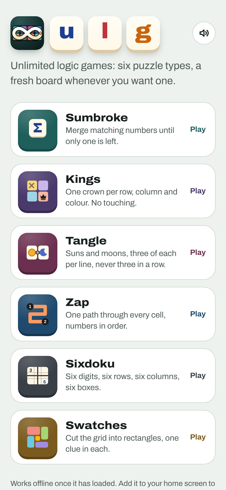
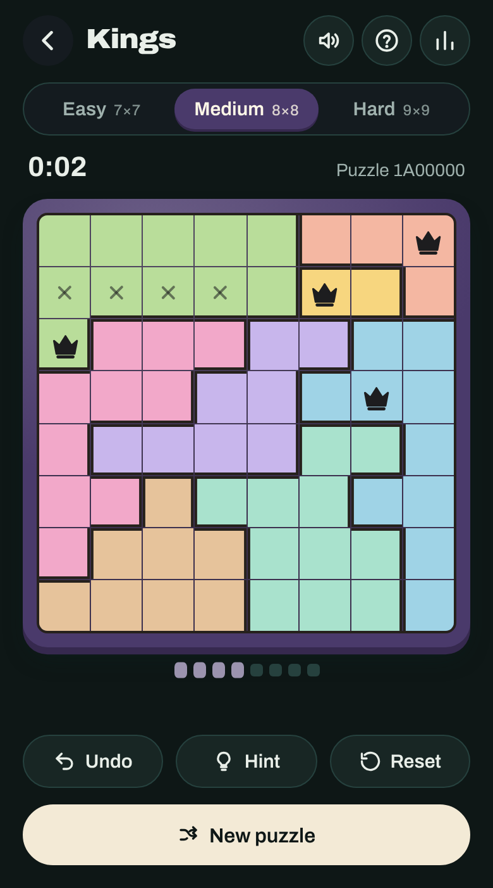

<p align="center">
  
</p>

<p align="center">
  
  
  
  
  
</p>

**ulg** is a pocket collection of six logic puzzles that never runs out. Every board is
generated on your device and has exactly one solution, and most take between one and
five minutes. Add it to your home screen and it plays like an app, with or without a
connection.

<p align="center">
  
</p>

## The games

<table>
  <tr>
    <td align="center" width="33%">
      <br>
      <b>Sumbroke</b><br>
      <sub>Drag a number onto a matching neighbour to merge them. Keep going until one number is left. Gold wildcards like <code>+3</code> or <code>×2</code> merge with any number.</sub>
    </td>
    <td align="center" width="33%">
      <br>
      <b>Kings</b><br>
      <sub>Place one king in every row, column and coloured region. Like kings in chess, they can never touch, not even diagonally.</sub>
    </td>
    <td align="center" width="33%">
      <br>
      <b>Tangle</b><br>
      <sub>Fill the grid with suns and moons: three of each per row and column, never three in a row. <code>=</code> means match, <code>×</code> means opposite.</sub>
    </td>
  </tr>
  <tr>
    <td align="center">
      <br>
      <b>Zap</b><br>
      <sub>Draw one path from 1 through every number in order. It has to fill every cell, and it can't cross a wall.</sub>
    </td>
    <td align="center">
      <br>
      <b>Sixdoku</b><br>
      <sub>Sudoku on a 6×6 grid: digits 1 to 6 once per row, column and 2×3 box. Pencil notes included.</sub>
    </td>
    <td align="center">
      <br>
      <b>Swatches</b><br>
      <sub>Cut the grid into rectangles with exactly one clue in each. A clue can give the size, the shape, both, or neither.</sub>
    </td>
  </tr>
</table>

Each game has an **Easy**, **Medium** and **Hard** level:

| Game | Easy | Medium | Hard |
| --- | --- | --- | --- |
| Sumbroke | 3×3, up to 1 wildcard | 4×4, 1–2 wildcards | 5×5, 2–3 wildcards |
| Kings | 7×7 | 8×8 | 9×9 |
| Tangle | 6×6, extra givens | 6×6 | 6×6, fewest givens |
| Zap | 6×6 | 7×7 with walls | 8×8, more walls |
| Sixdoku | 16 givens | 12 givens | as few as possible |
| Swatches | 5×5, full clues | 6×6, some shapes hidden | 7×7, sizes and shapes hidden |

## Why it's fun to play

- **It never runs out.** Tap *New puzzle* and a fresh board appears. A generator built for each game guarantees there's exactly one solution, so you never have to guess.
- **Hints actually help.** A hint clears anything that can't be right and shows the next step. In Sumbroke and Zap, it takes you back to your last good position first.
- **It feels like a game table.** You get chunky tiles you drag around, wooden clacks, chimes as a path grows, a soft buzz on phones, and a wave of confetti when you solve it.
- **Drawing is forgiving.** Zap's line follows your finger smoothly. Drags that overshoot the board's edge still land on the edge row. You can grab a swatch and drag its end back and forth to resize it.
- **You can challenge a friend.** Every board has a code, and *Challenge a friend* shares a link that rebuilds exactly the same puzzle.
- **It keeps your place.** Games in progress, best times, averages and hint-free streaks are all saved on the device.
- **It works anywhere.** It installs as an app and plays offline. It supports dark mode and full keyboard play, and it respects reduced motion.

<p align="center">
  
  &nbsp;
  
  &nbsp;
  
</p>
<p align="center"><sub>The home screen, a win in progress, and dark mode</sub></p>

## Play it

### Run it locally

You need Node.js 20 or newer.

```bash
npm install
npm run dev        # open http://localhost:3000
```

### Put it on your phone

Build the static site and host it anywhere that serves files over HTTPS:

```bash
npm run build      # writes the site to out/
npm start          # preview out/ locally
```

| Host | How |
| --- | --- |
| Vercel | Import the repo. The default settings work. |
| Netlify or Cloudflare Pages | Build command `npm run build`, publish directory `out` |
| GitHub Pages | `BASE_PATH=/your-repo npm run build`, then publish `out/` |

Then open the site on your phone and add it to your home screen:

- **Android (Chrome):** menu, then *Install app*.
- **iPhone (Safari):** Share, then *Add to Home Screen*.

From then on it plays offline.

> Offline mode only switches on in production builds. Use `npm run build && npm start`
> to try it on your computer.

## How the puzzles are made

<details>
<summary><b>Every board has exactly one solution. Here's how each generator gets there.</b></summary>

<br>

| Game | Method |
| --- | --- |
| **Sumbroke** | Starts from a single number and "un-merges" it until the board is full, so a solution always exists. A solver then makes sure the opening has real traps. |
| **Kings** | Places kings that don't touch, grows a coloured region around each one, then reshapes regions until a solver finds only one answer. |
| **Tangle** | Builds a valid grid of suns and moons, adds `=` and `×` signs, then removes givens one at a time while the answer stays unique. |
| **Zap** | Builds a random path through every cell. It then adds checkpoints and walls that rule out every rival path, and drops any checkpoint it doesn't need. |
| **Sixdoku** | Fills a valid grid, then removes digits while the answer stays unique, down to a target for each level. |
| **Swatches** | Splits the grid into random rectangles, places a clue in each, and checks uniqueness with an exact-cover search. Harder levels hide sizes and shapes as long as the answer stays unique. |

Puzzles come from a seeded random generator, so the same code always rebuilds the same board.
Generation runs in a Web Worker, so the screen never freezes. The puzzle tests generate
hundreds of boards and check that each one is deterministic, has exactly one valid solution,
and can be solved using hints alone.

</details>

## Under the hood

- **Next.js 16** (App Router, static export) with **React 19** and strict **TypeScript**.
- No backend and no tracking. Everything runs in the browser, and progress lives in `localStorage`.
- Sound effects are synthesized with the Web Audio API, so the project ships no audio files.
- A hand-written service worker precaches every page for offline play.
- The only font is Archivo, served from the app itself.

```
src/
  app/                 one folder per game route, home page, not-found page, manifest
  core/                game shell (timer, undo, hints, stats, saving), hub, sounds,
                       confetti, pointer-to-cell geometry, worker client
  games/<game>/        engine.ts (generator, rules, hints), Board.tsx, index.tsx (rules text)
  games/registry.ts    the list of games on the home screen
  styles/              shared styles plus one stylesheet per game
  worker/              the Web Worker that builds puzzles
public/                logo, icons, offline service worker
scripts/               icon and worker builds, service-worker precache, puzzle tests
docs/                  README images (banner.html is the banner's source)
```

| Command | What it does |
| --- | --- |
| `npm run dev` | Start the development server |
| `npm run build` | Build the static site into `out/` |
| `npm start` | Serve `out/` locally |
| `npm test` | Generate puzzles for every game and level, and verify them |
| `npm run typecheck` | Run the TypeScript checks |
| `npm run icons` | Redraw the logo and every app icon |

## Add your own game

Every game is a `GameDef`: its rules text, a board component, a generator and a hint.

1. Copy a game folder in `src/games/`. Write the generator and rules in `engine.ts` and the board in `Board.tsx`.
2. Register the game in `src/games/registry.ts`, `src/games/engines.ts` and `src/games/meta.ts`.
3. Add a route at `src/app/<id>/page.tsx` (copy one of the four-line pages) and import its stylesheet in `src/app/layout.tsx`.
4. Run `npm test`.

To rename a game, change `name` in its `index.tsx` and in `meta.ts`. Old addresses listed
in `LEGACY_IDS` forward to the new ones, and saved progress moves across automatically.

## Credits

Fan-made puzzles inspired by the daily logic games on LinkedIn. Not affiliated with or
endorsed by LinkedIn.

Set in [Archivo](https://fonts.google.com/specimen/Archivo) by Omnibus-Type (SIL Open
Font License). To use `docs/social-preview.png` as the link preview, upload it under
**Settings → Social preview** on GitHub.
